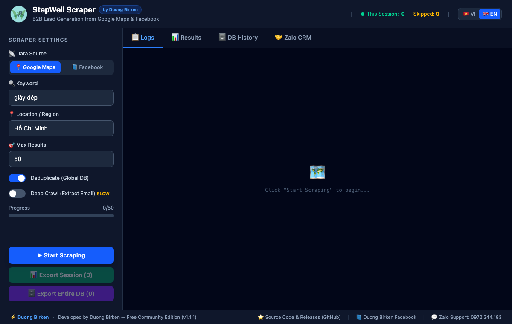
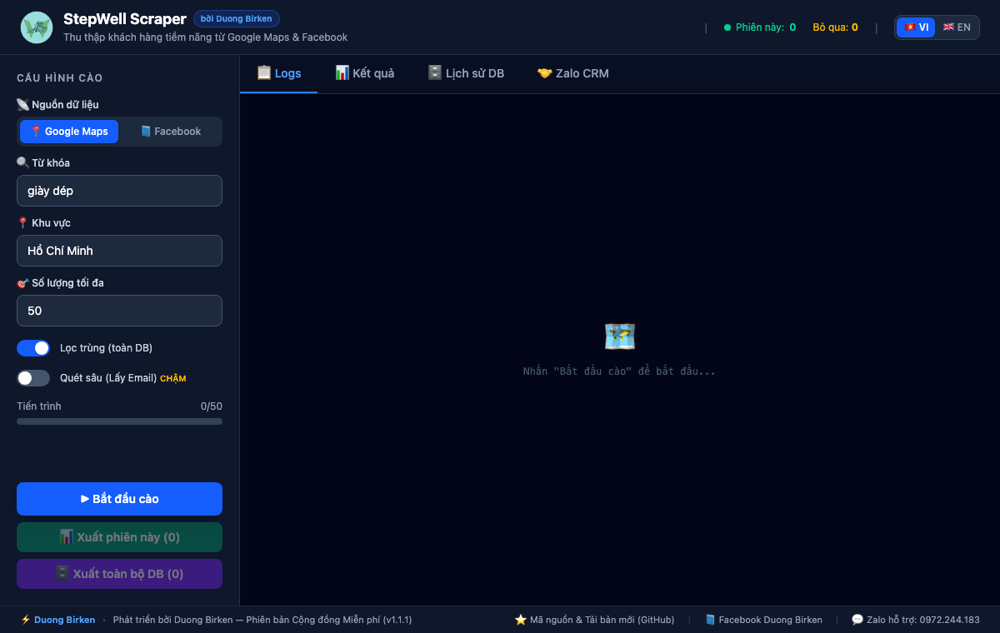
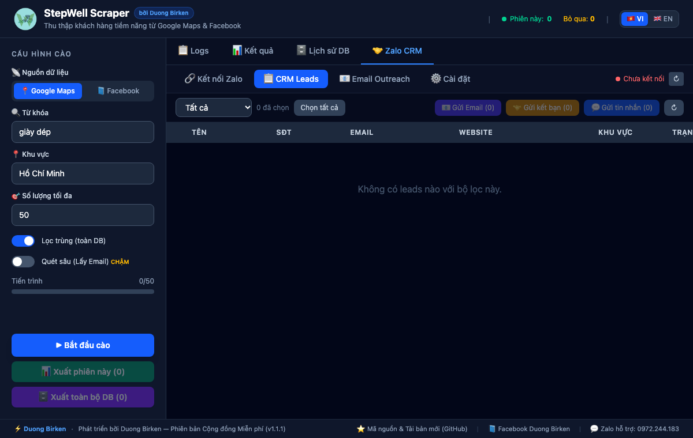
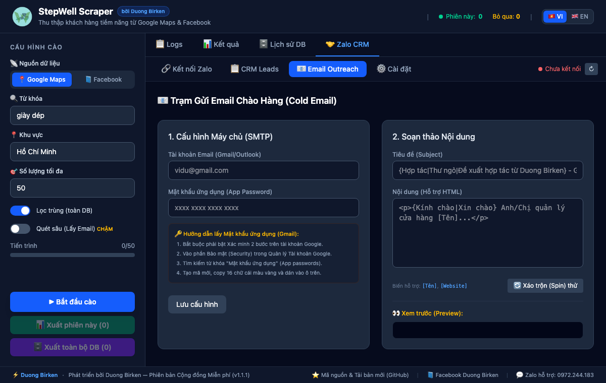

<div align="center">


# StepWell Scraper (Map-Scaper)

**All-in-One B2B Lead Generation (Google Maps & Facebook Pages), CRM Funnel, Zalo Automation & Cold Email Outreach Desktop Application**

*Ứng dụng Desktop thu thập khách hàng tiềm năng B2B từ Google Maps & Facebook Pages, tích hợp CRM quản lý phễu, tự động hóa Zalo và gửi Cold Email hàng loạt (Spintax).*

[](https://v2.tauri.app/)
[](https://www.rust-lang.org/)
[](https://react.dev/)
[](https://www.typescriptlang.org/)
[](https://www.sqlite.org/)
[](#)

[**📥 Download Installers (.exe / .dmg)**](https://github.com/duongbirken2510/Map-Scaper/releases) • [**🇬🇧 English Documentation**](#-english-overview) • [**🇻🇳 Tài Liệu Tiếng Việt**](#-tổng-quan-tiếng-việt) • [**📖 Hướng Dẫn Chi Tiết (VN)**](./HUONG_DAN_SU_DUNG.md)

</div>

---

## 📸 Screenshots / Hình Ảnh Giao Diện

### 1. Main Scraper Interface (English & Tiếng Việt)
| 🇬🇧 English Interface (`EN`) | 🇻🇳 Giao Diện Tiếng Việt (`VI`) |
| :---: | :---: |
|  |  |

### 2. Built-in CRM Funnel & Cold Email Spintax Station
| 🤝 Zalo CRM & Sales Funnel | 📧 Cold Email SMTP & Spintax Preview |
| :---: | :---: |
|  |  |

---

# 🇬🇧 English Overview

**StepWell Scraper (`Map-Scaper`)** is a high-performance, native desktop application built with **Rust (Tauri v2)** and **React 19**. It automates the entire B2B outbound pipeline—from discovering business leads on **Google Maps** and **Facebook Pages** to nurturing them through an integrated **CRM Funnel**, **Zalo Automation**, and **Cold Email Outreach**.

### ✨ Key Features

1. **Multi-Source Lead Scraping (`Google Maps` & `Facebook Pages`):**
   - **Google Maps Scraper:** Extracts business name, phone number, address, region, website, and email using headless Chrome (`chromiumoxide`) — **no login required**.
   - **Deep Crawl Mode:** Automatically visits each business's website and contact pages to extract verified corporate email addresses.
   - **Facebook Pages Scraper:** Smart browser login saves a persistent Chrome profile (`~/.stepwell-scraper/fb-profile/`), searches niche Fanpages by keyword + location, and extracts phone, email, address, website, category, and follower counts with built-in anti-detection delays.
2. **Global Cross-Session Deduplication & Excel Export:**
   - Embedded **SQLite** database (`rusqlite` bundled) ensures you never scrape or contact the same phone number or Facebook Page twice across sessions.
   - One-click `.xlsx` export for either the current scraping session or the entire database.
3. **Zalo CRM & Automated Outreach:**
   - **Dual Login Modes:** Scan a QR code directly inside the app or authenticate via browser Cookie (`z_uuid`, `UserAgent`, `Cookie JSON`). Sessions persist across restarts.
   - **Automated Friend Requests & Messaging:** Bulk-send personalized Zalo friend requests and direct messages using `[Tên]` variables, randomized human-like delays (`60–120s`), and daily safety caps.
4. **Cold Email Outreach Station with Spintax:**
   - Built-in SMTP client (`lettre` with TLS) for Gmail / Outlook using App Passwords.
   - Supports rich **HTML templates**, dynamic variables (`[Tên]`, `[Website]`), and **Spintax** (`{Hello|Dear|Greetings}`) with live randomized preview to bypass spam filters.
5. **Bilingual Interface (`🇻🇳 VI` / `🇬🇧 EN`):**
   - Instant one-click language switching in the top header bar.

### 🛠 Tech Stack

| Layer | Technology |
| :--- | :--- |
| **Desktop Core** | Tauri v2 (Rust) |
| **Frontend** | React 19, TypeScript 5.8, TailwindCSS v4, Vite 7 |
| **Browser Automation** | `chromiumoxide` (CDP over Tokio async runtime) |
| **Database** | SQLite (`rusqlite` with `bundled` feature — zero external DLLs) |
| **Zalo Engine** | Node.js Sidecar (`zca-js` bundled via `esbuild`) |
| **Mailer & Excel** | `lettre` (Async/Sync SMTP TLS), `rust_xlsxwriter` |

### 🚀 Getting Started (Development & Build)

#### Prerequisites
- **Google Chrome** installed on your system.
- **Node.js** `>= 18` & **Rust** (`cargo` via [rustup.rs](https://rustup.rs/)).

```bash
# 1. Install frontend & Zalo sidecar dependencies
npm install
cd src-tauri/zalo-sidecar && npm install && cd ../..

# 2. Launch in development mode (opens native StepWell Scraper desktop window)
npm run tauri dev

# 3. Build production installer (.dmg / .app on macOS, .exe / .msi on Windows)
npm run tauri build
```

---

# 🇻🇳 Tổng Quan Tiếng Việt

**StepWell Scraper (`Map-Scaper`)** là ứng dụng Desktop hiệu năng cao được xây dựng trên nền tảng **Rust (Tauri v2)** và **React 19**, giúp tự động hóa trọn vẹn quy trình tìm kiếm và tiếp cận khách hàng tiềm năng B2B: từ khâu quét dữ liệu trên **Google Maps** & **Facebook Pages** cho đến quản lý phễu **CRM**, kết bạn/nhắn tin **Zalo tự động** và gửi **Cold Email hàng loạt**.

### 🌟 Tính Năng Nổi Bật

1. **Cào Dữ Liệu Đa Nguồn (`Google Maps` & `Facebook Pages`):**
   - **Quét Google Maps (Không cần đăng nhập):** Tự động điều khiển trình duyệt Chrome ẩn để bóc tách Tên cửa hàng, Số điện thoại, Địa chỉ, Khu vực, Website.
   - **Quét Sâu Lấy Email (`Deep Crawl`):** Tự động truy cập vào Website của từng địa điểm trên Google Maps để dò tìm địa chỉ Email liên hệ.
   - **Quét Facebook Pages:** Đăng nhập 1 lần qua trình duyệt Chrome (tự động lưu hồ sơ tại `~/.stepwell-scraper/fb-profile/`), tìm kiếm Fanpage theo từ khóa + khu vực và trích xuất SĐT, Email, Địa chỉ, Website, Danh mục, Lượt theo dõi kèm cơ chế nghỉ ngẫu nhiên chống chặn.
2. **Lọc Trùng Toàn Cục (SQLite) & Xuất File Excel:**
   - Tự động đối chiếu và bỏ qua các SĐT hoặc Fanpage đã có trong Database từ những lần quét trước.
   - Hỗ trợ xuất nhanh ra file Excel (`.xlsx`) cho riêng phiên hiện tại hoặc toàn bộ cơ sở dữ liệu.
3. **Zalo CRM & Chăm Sóc Khách Hàng Tự Động:**
   - **Đăng nhập linh hoạt:** Quét mã QR trực tiếp trên ứng dụng hoặc đăng nhập bằng Cookie (`z_uuid`, `UserAgent`, `Cookie JSON`), tự động lưu phiên cho các lần mở sau.
   - **Quản lý phễu CRM trực quan:** Phân loại trạng thái (`Mới` → `Đã gửi Email` / `Đã KBạn` / `Đã nhắn` → `Đã chấp nhận` → `Đã phản hồi` → `Khách hàng` / `Từ chối`) và lưu ghi chú đàm phán.
   - **Chiến dịch tự động:** Gửi lời mời kết bạn và nhắn tin hàng loạt cá nhân hóa theo biến `[Tên]` với độ trễ ngẫu nhiên an toàn (`60–120 giây`).
4. **Trạm Gửi Cold Email Hàng Loạt & Công Nghệ Spintax:**
   - Tích hợp gửi email qua SMTP (Gmail / Outlook bằng Mật khẩu ứng dụng 16 ký tự).
   - Hỗ trợ soạn thảo HTML, chèn biến `[Tên]`, `[Website]` và trộn nội dung ngẫu nhiên bằng cú pháp **Spintax** `{Chào|Xin chào|Kính gửi}` kèm khung xem trước trực tiếp.
5. **Hỗ Trợ Song Ngữ (`🇻🇳 VI` / `🇬🇧 EN`):**
   - Chuyển đổi tức thì giữa giao diện **Tiếng Việt** và **Tiếng Anh** ngay trên thanh Header.

### 📖 Tài Liệu Hướng Dẫn Sử Dụng Chi Tiết
Xem toàn bộ hướng dẫn từng bước cho người dùng cuối và cách xử lý sự cố tại:
👉 **[HUONG_DAN_SU_DUNG.md](./HUONG_DAN_SU_DUNG.md)**

---

## 👤 Author & Community Support / Tác Giả & Liên Hệ

Developed and shared free for the community by **Duong Birken**:
- ⭐ **GitHub:** [github.com/duongbirken2510/Map-Scaper](https://github.com/duongbirken2510/Map-Scaper)
- 📘 **Facebook:** [facebook.com/duongbirken](https://www.facebook.com/duongbirken)
- 💬 **Zalo / Hotline:** [0972.244.183](https://zalo.me/0972244183)

---

## 📄 License
Copyright © 2026 **Duong Birken**. Free Community Edition.
